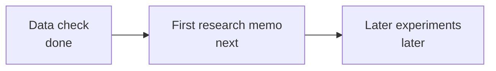
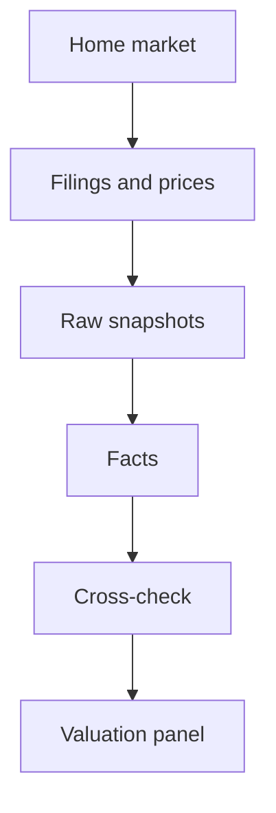

# Project summary card

**You are here.** On 31 October 2026 (Europe/Stockholm) the data check for NVIDIA, ASML, and TSMC is recorded as passed, with 11 of 12 facts valid for each company. Next is a review of that result, then the first research memo. The top of the README still calls the data check in progress; the later "Current status" section is the record of the pass. The report files are not stored in git.

## 1. Goal

Epilith is a research aid for AI-infrastructure stocks. It gathers facts, shows its working, and leaves the decision to a person. It never places a trade.

The question this step answered: for NVIDIA, ASML, and TSMC, can a program fetch a small set of financial and market facts, say what each number means, name its source and period, recompute the derived figures, and flag disagreements in the open?

**Done means:** a person can read a sourced memo and decide whether a name is a candidate, a watch, or an avoid, with the numbers taken from stored facts.

**Outside this work:** trading, automatic position size, a graph database, and vector search.

## 2. Order of work

The data check is recorded as done. The first research memo is next.

Each step ends when:

- Data check: all three companies have at least 11 of 12 required facts valid, and every disagreement is labeled.
- First research memo: one company, validated facts, quotes checked by code, a thesis, a separate challenge, and a decision log that is never overwritten.
- Later experiments: extra pieces are added only when a trial shows they help.

**Ideas for later, not on this path:** a comparison of extra agents, a hand-kept map of AI-infrastructure suppliers, a read-only portfolio view, idea screening, and scheduled re-checks.

## 3. How the pieces connect

A stock is sent to its home market first. Filings and prices become stored facts. A checker compares a second source. A small panel turns the facts into descriptive multiples.

| Piece | Job | Talks to |
|---|---|---|
| Company and market config | Names the three stocks and which exchange is home | Ingestion |
| Providers | Fetch US filings, European filings, Taiwan filings, company reports, and prices | Raw store |
| Snapshots | Keep the fetched bytes with a content hash and leave older copies in place | Facts |
| Validation | Score 12 fields and require a second source on 8 of them | Report |
| Valuation | Compute market value, enterprise value, trailing price-to-earnings, enterprise value over sales, and free-cash-flow yield | Report |

## 4. Checks

| Check | What it shows | What it must not be treated as |
|---|---|---|
| 11 of 12 fields valid | The value, unit, currency, period, and source are known, and the required second reading agrees or the one miss is inside the bar | A reason to buy or sell |
| Second source within 1% | Another origin states the same period and the same calculation | Proof that two accounting rule sets match. A rule-set gap is written beside the kept figure |
| Fixture tests in `tests/` | Formulas, periods, listings, and table parsing behave on saved examples | A fresh live fetch. This checkout did not run them; the Python packages are not installed here |

Recorded result, from the README:

| Company | Valid | Still open |
|---|---|---|
| NVIDIA | 11/12 | The last twelve months match the company's quarterly releases. That release does not state the share count. |
| ASML | 11/12 | The kept figure is the European full year 2025. Sales and equipment purchases match the company report. Profit and cash from the business differ where the company report uses US rules. The share count is the miss. |
| TSMC | 11/12 | Sales, profit, cash from the business, and equipment purchases match. The share count matches capital stock divided by the exchange's face amount. Borrowings are the miss. |

## 5. Shape of the ending

The data-check write-up, in this order:

1. Validation table: company, metric, value, unit, currency, period, source, second source, difference, status.
2. Per-company score: `NVDA`, `ASML`, and `TSMC`, each as valid fields out of 12.
3. Discrepancy report, with a class on every gap.
4. Valuation panel, with the dates of its inputs.
5. Findings note: what broke, what was hard, and what the schema had to change.

The next write-up is the first research memo: business, AI-infrastructure exposure, key facts, evidence, interpretation, bull case, bear case, risks, valuation, the three assumptions most likely to be wrong, how to verify the top claims, and a research conclusion.
